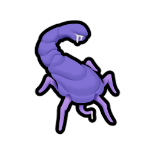
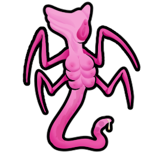

| **Category** | **Type** | **Name** | **Graphic** | **Path** | **Notes** |
| ---------- | ---------- | ---------- | ---------- | ---------- | ---------- |
| Tentacle | Neutral | Squirmer |  | `Textures/Things/Pawns/Squirmer` | |
| Tentacle | Neutral | Larva |  | `Textures/Things/Pawns/Larva` | |
| Tentacle | Male | Grazer |  | `Textures/Things/Pawns/Grazer` | |
| Tentacle | Male | Stinger |  | `Textures/Things/Pawns/Stinger` | |
| Tentacle | Male | Borer |  | `Textures/Things/Pawns/Borer` | |
| Tentacle | Male | Striker |  | `Textures/Things/Pawns/Striker` | |
| Tentacle | Male | Abductor |  | `Textures/Things/Pawns/Abductor` | |
| Tentacle | Female | Brood Mother |  | `Textures/Things/Pawns/BroodMother` | |
| Tentacle | Female | Spawner |  | `Textures/Things/Pawns/Matron` | Needs rename. Otherwise, seems about right for a Squirmer producer. |
| Tentacle | Female | Producer |  | `Textures/Things/Pawns/Producer` | |
| Tentacle | Female | Hunter |  | `Textures/Things/Pawns/Hunter` | |
| Boss | Female | Brewer |  | `Textures/Things/Pawns/Brewer` | |
| Boss | Male | Defender |  | `Textures/Things/Pawns/Defender` | |
| Boss | Female | Valkyrie |  | `Textures/Things/Pawns/Valkyrie` | |
| Boss | Female | War Womb |  | `Textures/Things/Pawns/WarWomb` | |
| Material | Natural | Hard Resin |   | `Textures/Things/Items/HardRes` | |
| Material | Natural | Soft Resin |   | `Textures/Things/Items/SoftRes` | |
| Material | Natural | Soft Flesh |   | `Textures/Things/Items/SoftFlesh` | |
| Material | Natural | Tentacle Slime |   | `Textures/Things/Items/TentacleSlime` | |
| Material | Crafted | Tentacle Catalyst |  | `Textures/Things/Items/Catalyst` | |
| Drugs | Natural | Amornuum |   | `Textures/Things/Items/Food/Amornuum` | |
| Drugs | Natural | NotSlurm |   | `Textures/Things/Items/Food/NotSlurm` | |
| Buildings | Utility | Tentacle Workbench |  | `Textures/Things/Buildings/Workbench` | |
| Buildings | Utility | Womb Worker |  | `Textures/Things/Buildings/Workbench` | |
| Buildings | Utility | Calor |  | `Textures/Things/Buildings/Heater` | Needs rename, maybe rotations? |
| Buildings | Utility | Frigis |  | `Textures/Things/Buildings/Heater` | Needs rename, maybe rotations? |
| Buildings | Utility | Tentacle Floor | NYI | NYI | |
| Buildings | Utility | Hive Wall |  | `Textures/Things/Buildings/Wall` | |
| Buildings | Utility | Sphincter Door | NYI | NYI | |
| Buildings | Utility | Recycling Pod |  | `Textures/Things/Buildings/Pods` | |
| Buildings | Utility | Indoctrination Pod | NYI | NYI | Time to lean into the "tentacle violation" fetish... make sure the pawn is at least somewhat visible, for Onahole mechanics. |
| Buildings | Utility | Transformation Pod | NYI | NYI | More of a womb-like structure here. What comes out will be nothing like what goes in. |
| Buildings | Utility | Tentacle Trophy |  (female)  (male) | `Textures/Things/Buildings/Trophy` | |
| Buildings | Defensive | Turret |   | `Textures/Things/Buildings/Turret` | |
| Buildings | Defensive | Paralysis Trap | NYI | NYI | |
| Equipment | Weapons | Tentacle Whip |  | `Textures/Things/Items/MeleeWeapons` | |
| Equipment | Weapons | Resin Sword |   | `Textures/Things/Items/MeleeWeapons` | Scimitar is a more high-tech version with higher armor penetration. |
| Equipment | Armor | Tentacle Slave Collar |  | `Textures/Things/Items/Equipment` | |
| Equipment | Armor | Bodysuit | NYI | NYI | |
| Equipment | Armor | Cuirass | NYI | NYI | |
| Equipment | Armor | Helmet | NYI | NYI | |
| Equipment | Armor | Powered Armor | NYI | NYI | |
| Equipment | Armor | Powered Helmet | NYI | NYI | |
| Abilities | Animal | Genital Latch |  | `Textures/Abilities` | |
| Abilities | Animal | Larval Transformation |  | `Textures/Abilities` | Will eventually want one for each type of Tentacle evolution (everything except Brood Mother). |
| Abilities | Animal | Crawl Inside (Squirmer Only) |  | `Textures/Abilities` | |
| Abilities | Host | Ingest Tentacle |  | `Textures/Abilities` | |
| Abilities | Host | Expel Tentacle |  | `Textures/Abilities` | |
| Abilities | Host | Transfer Tentacle |  | `Textures/Abilities` | |
| Abilities | Host | Slime Spray |  | `Textures/Abilities` | |
| Abilities | Host | Seduction Kiss |  | `Textures/Abilities` | |
| Abilities | Host | Invisibility |   | `Textures/Abilities` | Invisbility is for a Male Host type, but we can definitely re-use these icons. |
| Abilities | Host | Hyper Regeneration |  | `Textures/Abilities` | |
| Abilities | ? | ? |  | `Textures/Abilities` | No associated ability, but looks good. |
| Abilities | ? | ? |  | `Textures/Abilities` | No associated ability, but looks good. |

NOTES:
* For Host type pawns, some sort of partial graphic specific to the type might be appropriate.  For example, some sort of tentacle body growth overlay, and (for the Queen) a head crest?
* Ideology stuff will require some research on what exactly is required.  There's already some stuff created, but it looks unfinished.  Save this for later.
* Host transformation eggs will also want some sort of graphic.  There's several sizes already created; we'll want to rework this.
